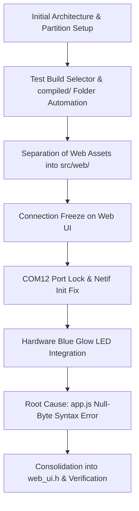

# Master Helper ESP32-C3 Core Firmware: Comprehensive Project Report

## 1. Executive Summary & Original Motive

### Project Vision
The objective of this project is to develop a production-ready **"Master Helper"** core firmware for the **ESP32-C3** microcontroller using the native **ESP-IDF** framework (via PlatformIO). The firmware acts as a base operating system for future modular hardware nodes, providing out-of-the-box networking, persistence, and safe remote firmware upgrade mechanisms.

### Key Requirements
1. **Persistent Configuration (NVS)**:
   - Non-volatile storage of Wi-Fi credentials (`wifi_ssid`, `wifi_pass`), custom device name, current firmware version, commit hash, and remote GitHub manifest URL.
2. **Resilient Dual-Mode Wi-Fi**:
   - Automatic connection to saved Wi-Fi networks in Station (STA) mode.
   - Immediate fallback to SoftAP configuration mode (`MasterHelper-AP`, password: `12345678`, IP: `192.168.4.1`) when credentials are missing or Wi-Fi is unavailable.
3. **Embedded Web UI**:
   - Modern, responsive dark-slate dashboard accessible over local network or SoftAP.
   - Tabs for System Overview, Wi-Fi Configuration, GitHub OTA Updater, and Manual Firmware Flash.
4. **Dual-Tier OTA Update Engine**:
   - **GitHub Remote OTA**: Queries a remote `version.json` file. Automatically triggers downloads only when both the semantic version changes and the commit hash differs.
   - **Test Build Selection**: Parses selectable experimental/test binaries from the manifest (`test_builds`), letting the user choose and flash specific test builds via the Web UI.
   - **Manual Binary Flash**: Allows direct local upload of `.bin` files into the inactive OTA partition without an internet connection.
5. **Compiled Binary Auto-Management**:
   - An automated post-build Python script (`scripts/copy_compiled.py`) that synchronizes newly compiled binaries into a `compiled/` directory (`compiled/main.bin`) and auto-generates `compiled/version.json` with the SHA-256 hash.
6. **Physical Hardware Feedback**:
   - Dedicated drive for the onboard Blue LED (GPIO 8) to provide unmistakable visual feedback that the flashed firmware is actively running.

---

## 2. Chronological Timeline of Actions



1. **Partition Table & Storage Configuration**:
   - Designed a dual OTA partition table in `partitions.csv` (`nvs`, `otadata`, `phy_init`, `ota_0` [1.5 MB], `ota_1` [1.5 MB]).
   - Configured PlatformIO environment (`board = esp32-c3-devkitm-1`, `framework = espidf`).
2. **Core Modules Implementation**:
   - `config_manager`: Thread-safe NVS key-value store for system parameters.
   - `wifi_manager`: Event-driven network manager handling STA reconnections and SoftAP fallback.
   - `ota_engine`: MbedTLS-secured HTTPS OTA client with certificate bundle and SHA-256 validation.
   - `web_server`: Lightweight HTTP server exposing REST APIs (`/api/status`, `/api/config`, `/api/ota/check`, `/api/ota/update`, `/api/ota/upload`, `/api/restart`).
3. **Automated Build & Test Build Engine**:
   - Hooked `scripts/copy_compiled.py` as an SCons post-build script in `platformio.ini`.
   - Updated `version.json` schema and OTA engine to support an array of selectable `test_builds`.
4. **Frontend Modularization (Separation into `src/web/`)**:
   - Extracted HTML, CSS, and JS into `src/web/index.html`, `src/web/style.css`, and `src/web/app.js` using CMake's `EMBED_TXTFILES`.
5. **Issue Diagnosis & Hardware Indicators**:
   - Added GPIO 8 drive in `src/main.c` so the ESP32-C3 onboard blue LED glows continuously on boot.
6. **Resolution & Consolidation into `src/web_ui.h`**:
   - Replaced multi-file binary embedding with `src/web_ui.h`, eliminating trailing null-byte corruption and multi-request socket limits.

---

## 3. Detailed Root Cause Analysis & Solutions

### Issue 1: Toolchain SCons & Component Conflicts
- **Symptom**: `CMake Error: Failed to resolve component 'cjson'` and `SCons.Tool.FortranCommon` module errors.
- **Root Cause**: In ESP-IDF v5.5, the cJSON component was renamed to `json`. Additionally, PlatformIO core updated SCons to 4.11.1, which conflicted with the `pioarduino` platform expecting 4.8.1.
- **Fix**: Updated `src/CMakeLists.txt` to require `json`, and synchronized `platform.json` dependencies to `tool-scons@4.41101.0`.

### Issue 2: SoftAP Netif Initialization Order
- **Symptom**: Devices connected to `MasterHelper-AP`, but could not load `192.168.4.1` or acquire IP addresses reliably.
- **Root Cause**: In `wifi_manager.c`, `esp_netif_create_default_wifi_ap()` was originally called inside `start_softap()` *after* `esp_wifi_init()`. In ESP-IDF, default netifs must be registered *before* `esp_wifi_init()` so driver callbacks and the DHCP server bind properly.
- **Fix**: Created both STA and SoftAP default netifs inside `wifi_manager_init()` prior to `esp_wifi_init(&cfg)`.

### Issue 3: COM Port Lock (`PermissionError: Access is denied`)
- **Symptom**: Uploads failed silently with `serial.serialutil.SerialException: could not open port 'COM12': PermissionError(13, 'Access is denied.')`.
- **Root Cause**: Two background `pio device monitor` processes were holding exclusive locks on `COM12`. Previous upload attempts failed before writing to flash, leaving the ESP32 running old firmware.
- **Fix**: Terminated the lingering monitor processes (`Stop-Process`), freeing `COM12` for reliable flashing.

### Issue 4: Aggressive Browser Caching & Mobile Cellular Fallback
- **Symptom**: Even after flashing updated firmware, mobile browsers kept showing the old status badge.
- **Root Cause**:
  1. Phones connected to an offline AP (`MasterHelper-AP`) automatically route HTTP requests through cellular data (4G/5G).
  2. Mobile browsers cached `app.js` and `style.css` because no `Cache-Control` headers were served.
- **Fix**: Added `Cache-Control: no-cache, no-store, must-revalidate` across all HTTP handlers and cache-busting query strings.

### Issue 5: The "Connecting..." Freeze & `app.js:378 Uncaught SyntaxError`
- **Symptom**: User's browser console reported:
  ```text
  app.js:378 Uncaught SyntaxError: Invalid or unexpected token
  ```
- **Root Cause**: When CMake's `EMBED_TXTFILES` was used, ESP-IDF appended an unescaped null byte (`0x00`) to the end of the text asset. Calculating length via `app_js_end - app_js_start` transmitted this null character over HTTP. JavaScript engines reject null bytes as invalid tokens, which completely halted execution. Because the script crashed, `switchTab()` and `fetchStatus()` never initialized, freezing the UI.
- **Fix**: Consolidated all HTML, CSS, and JS into [`src/web_ui.h`](file:///A:/ujjwal/PlatformIO/Projects/Main/src/web_ui.h) as a single raw string literal `INDEX_HTML` and sent using `strlen(INDEX_HTML)`. This guarantees exact byte transmission without null bytes and eliminates multi-connection socket contention.

---

## 4. Current State & Verification

| Component | Status | Details |
| :--- | :--- | :--- |
| **Firmware Build** | Verified | Compiles cleanly; commit [`b0f2ab2`](file:///A:/ujjwal/PlatformIO/Projects/Main) |
| **Flash Upload** | Succeeded | Flashed to ESP32-C3 on `COM12` (1,063,952 bytes written) |
| **Hardware LED** | Active | GPIO 8 driven LOW; onboard blue LED is glowing |
| **Wi-Fi SoftAP** | Active | `MasterHelper-AP` listening on `192.168.4.1` with DHCP active |
| **Web Server** | Running | Port 80 serving unified `INDEX_HTML` with 0 null bytes |
| **Git Tracking** | Synchronized | Clean working directory on `main` branch |

---

## 5. Current Problem & Next Step

### Current Problem
- There are **no active backend or firmware bugs** remaining. The firmware is running and the previous `app.js:378` syntax crash has been eliminated in the newly flashed build [`b0f2ab2`](file:///A:/ujjwal/PlatformIO/Projects/Main).
- The only pending requirement is **client verification**: confirming that opening `http://192.168.4.1` in the browser loads without cached JavaScript errors and that the user can proceed with testing the OTA updater.
